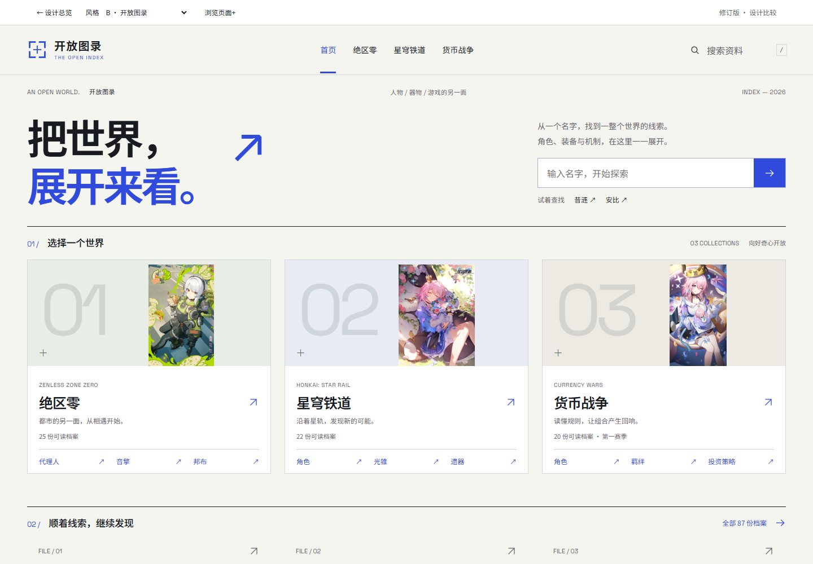

# 开放图录 · 方案定稿与开发交接

> 定稿日期：2026-10-13。用户已确认采用「开放图录」作为后续界面设计方向，并指定首页使用电脑桌面上的三张原图。本文件记录 2026-10-13 定稿方案和后续生产接入依据；历史 Demo 状态与最新补记分别标注。

## 1. 决策与当前状态

| 项目 | 定稿内容 |
| --- | --- |
| 中文名称 | 开放图录 |
| 英文标识 | THE OPEN INDEX |
| Demo 主题标识 | `orbital`，原八套方案中的 B |
| 设计定位 | 现代资料馆：清晰的索引、可快速比较的图鉴、紧凑且可深入的资料阅读 |
| 品牌表达 | 钴蓝取景标记、中文无衬线字体、编号图版、细线网格、克制留白 |
| 首页主标题 | 把世界，展开来看。 |
| 首页板块顺序 | 绝区零 → 星穹铁道 → 货币战争 |
| 配图决策 | 使用用户电脑桌面上的安比生日图、三月七花束图、三月七蛋糕图，映射见第 3 节 |
| 实现状态 | 2026-10-13 定稿时为独立 Demo；后续生产实现和本次验收见文末「实施状态补记」 |

设计决策和当时 Demo 记录保留为历史基线；本次交接后，主项目正式入口已接入开放图录，详情见文末「实施状态补记」。历史八套探索稿与万象书局比较稿继续作为参考资料保留。

本节记录的是 2026-10-13 定稿时的状态；本次后续实现和验收补记见文末。本次工作不执行数据库同步、部署或发布。

## 2. 预览与工作区位置

| 入口 | 地址 |
| --- | --- |
| 开放图录首页 | [打开首页](http://127.0.0.1:5185/demo.html#/orbital) |
| 角色图鉴 | [打开角色图鉴](http://127.0.0.1:5185/demo.html#/orbital?view=list&category=hsr%2Fcharacters) |
| 昔涟详情 | [打开同一角色详情](http://127.0.0.1:5185/demo.html#/orbital?view=list&category=hsr%2Fcharacters&entry=hsr%2Fcharacters%2F1415) |
| 绝区零世界页 | [打开世界页](http://127.0.0.1:5185/demo.html#/orbital?view=world&category=zzz%2Fagents) |
| 货币战争第一赛季 | [打开赛季页](http://127.0.0.1:5185/demo.html#/orbital?view=season&category=currency%2Fseason1%2Froles) |
| 历史方案比较 | [打开设计总览](http://127.0.0.1:5185/demo.html#/) |

**原 Demo 源码最初在单独 worktree 中定稿；下列相对路径现指向主项目内已迁移的实现。源快照清单仍保留定稿时的 worktree/HEAD 信息，属于历史快照，不是本次提交的来源证明。**

定稿时的主项目与 Demo worktree 不自动同步；截至本补记，所选界面实现、必要共享组件与资源已迁入主项目并纳入本次提交。本文源码路径已改为相对主项目路径，原 worktree 的定稿快照信息仅保留在证据清单中。

当前源码和配图的内容散列见 [定稿文件清单](./assets/open-index-2026-10-13/source-manifest.json)。该清单用于识别本次定稿文件，不代替整个工作区的备份。

## 3. 首页图片：明确的最终对应

这里的「桌面」指用户电脑桌面的文件，不是某一种 Demo 风格。三个文件已与项目内现有封面逐一核对，SHA-256 完全一致；页面直接引用项目内副本，不依赖运行时访问电脑桌面。

| 首页入口 | 采用的图片 | 原始桌面文件名 | 原图尺寸 | 页面资源 |
| --- | --- | --- | --- | --- |
| 绝区零 | 安比生日图 | `3136fa60b486593948a0e3a7f7159e9c_3789252039600726563.png` | 600 × 930 | `/demo-art/covers/zzz.png` |
| 星穹铁道 | 三月七花束图 | `500px-2025三月七.png` | 500 × 667 | `/demo-art/covers/hsr.png` |
| 货币战争 | 三月七蛋糕图 | `e1c08a5d47de6238a1e45cacdb8f04ff_2236671098876582948.png` | 500 × 889 | `/demo-art/covers/currency.png` |

原文件目录为 `C:/Users/hengxing/Desktop`。项目内来源、尺寸和哈希记录见 [covers/sources.json](../public/demo-art/covers/sources.json)。

图片使用要求：

- 保持 `object-fit: contain`，完整呈现原图，不拉伸，不以放大裁切替代尺寸适配。
- 通过图框、底色和编号组织画面；标题与入口说明放在独立文字区。
- 手机沿用完整原图缩略图和横向入口，不把三张图做成长海报堆叠。
- 货币战争入口使用的三月七图是用户选定的配图，不应表述为货币战争专属官方宣传图。
- 本次指定替换的范围是**首页三个世界入口**。世界页及赛季页仍使用 `WORLDS_COPY` 中的独立立绘：安比 `zzz-1011.png`、三月七 `hsr-1224.png`、爻光 `hsr-1502.png`。图鉴与详情图像也继续按条目素材读取。

最新桌面首页，已包含三张指定图片：



手机截图：[390px 首页首屏](./assets/open-index-2026-10-13/home-mobile-first.png)。

## 4. 视觉规范与响应式原则

### 色彩与字体

以下为当前主题外壳的基础变量。组件中还存在用于图框、表格和提示区的局部浅色，不应将主题变量机械替换成所有组件的唯一颜色。

| 用途 | 当前值 | 使用方式 |
| --- | --- | --- |
| 页面背景 `--bg` | `#f5f5f0` | 浅色中性底 |
| 次级表面 `--surface` | `#eceeea` | 次级图框与层次 |
| 主要文字 `--ink` | `#181c21` | 标题、核心信息 |
| 辅助文字 `--muted` | `#5e626b` | 分类、说明、日期 |
| 分隔线 `--line` | `#d4d7d9` | 细线与结构边界 |
| 索引色 `--accent` | `#304adb` | 当前导航、链接、数字统计、主要动作 |
| 强调按钮文字 | `#ffffff` | 钴蓝实底上的文字 |
| 中文字体 | `Archive Sans` | 本地 Noto Sans SC 字体；覆盖标题、正文和控件 |
| 数字与拉丁字标 | `Space Grotesk`，中文回退 `Archive Sans` | 编号、数值与英文辅助标记 |

字体定义位于 [edition-fonts.css](../src/demo/edition-fonts.css) 与 [fonts.css](../src/demo/fonts.css)。本次生产实现连同本地字体资源及对应 OFL 授权文本一起保留。

图鉴与详情的有效辅助信息以至少 12px 为目标；正文以 15–16px 为主。品牌英文小字、图号等装饰标记存在更小字号，不应把重要状态或操作说明降到装饰字号。手机搜索和精确数值输入使用适合触屏阅读的字号。

### 布局和密度

- 页面主体最大宽度 1440px；常规桌面左右留白 48px，中间尺寸 32px，手机 20px。
- 详情外层最大宽度 1280px，桌面主要正文行宽约 780px；390px 手机实测正文宽约 350px。
- 图鉴采用容器宽度判断列数：内容容器达到 920px 时显示四列，否则主要采用两列。正式接入后应按容器宽度检查，不仅检查设备宽度。
- 760px 及以下使用手机布局：横向首页入口、收起的章节目录、紧凑档案头。
- 首页还根据视口高度压缩标题和装饰信息。三个世界的完整入口优先于大标题和大图的展示面积。
- 保留清晰的键盘焦点、当前导航状态、错误与空状态；减少动效偏好下关闭非必要过渡。
- 阅读表格可以局部横向滚动，页面整体不应横向溢出。不要用整页 `overflow: hidden` 掩盖内容越界。

## 5. 页面与交互定稿

| 页面 | 内容与布局 | 必须保留的行为 |
| --- | --- | --- |
| 首页 | 品牌、主标题、全站搜索、三个世界入口、继续发现、来源说明 | 首页搜索跨世界查找；空搜索进入全部可读样本；三入口首屏完整 |
| 世界页 | 世界标题、资料数量、分类目录、人物图鉴、机制入口 | 分类数字使用真实快照；入口导向对应世界与类别 |
| 赛季页 | 赛季标题、S1/S2、角色及五类资料目录 | 当前赛季明确；切换后类别与条目来自对应赛季 |
| 分类图鉴 | 分类导航、搜索、筛选、结果说明、图版/列表、分页 | 每页 8 条；显示模式保留在当前会话；无结果可清除条件恢复 |
| 档案详情 | 身份摘要、数值口径、分组、章节目录、正文、来源与相关档案 | 选组保留按钮焦点并记住该组章节；选章聚焦正文；手机选章后收起目录 |
| 活动与机制 | 日期图签或公式图签，配合对应正文 | 日期来自来源字段；不把历史活动自动标成当前活动 |

16 类代表页面包括：首页、分类图鉴、角色、武器、套装、邦布、敌人、活动时间列表、活动详情、机制文章、赛季总览、赛季角色、羁绊、物品、投资策略、投资环境。具体样本定义见 [themes.js](../src/demo/themes.js)。

交互约定：

1. `/` 快捷键聚焦全站搜索；在输入框或编辑区域内输入时不抢占正常键入。
2. 图鉴可切换「图版 / 列表」，使用 `open-index:collection-view` 保存当前会话偏好；存储不可用时仍可浏览。
3. 三月七、开拓者等同名角色显示命途，货币战争角色显示星阶；混合结果显示世界和类别。
4. 进入详情再返回时保留来源列表的搜索、筛选、分页、滚动和触发链接焦点。相关档案继续继承原始浏览来源，避免返回参数层层嵌套。
5. 分页后聚焦结果提示；筛选选择器正在操作时，不无故移走其焦点。
6. 等级控件使用滑动条和可编辑数字，支持键盘逐档、Home/End、非法输入恢复；缺失档位按已有数据处理，不插造数值。
7. 章节按概览、战斗、养成、配装、故事、机制等分组；空章节去除，来源核验通过单独入口访问。各组章节记忆只在当前档案组件存活期间保留，不是跨刷新保存的阅读进度。
8. 来源入口直接展开来源记录并移动焦点；窄表不制造多余滚动提示，宽表保留可操作的局部滚动区。
9. 缺图使用首字占位和相应提示；不拿其他角色图片填补缺失内容。

参考实页：[桌面图鉴](./assets/open-index-2026-10-13/list-first.png)、[桌面详情首屏](./assets/open-index-2026-10-13/detail-first.png)、[手机详情](./assets/open-index-2026-10-13/detail-mobile.png)。

## 6. 数据与来源口径

当前 Demo 从 `/demo-data/index.json` 及条目 `detailFile` 对应的本地 JSON 读取资料，快照生成时间为 **2026-10-12T02:03:52.067Z**。当前包含 **87 个可读样本、23 个分类**。目录总数 **2675** 属于目录统计，不等于定稿 Demo 中提供 2,675 个完整条目；生产入口现直接读取正式目录，见文末补记。

- 资料快照时间不等于游戏版本时间，也不等于正式站数据库同步完成时间。
- HSR 角色摘要明确基础属性 Lv.1；已确认的光锥 `21003`、`22009`、`23065` 使用 Lv.80 口径。
- 光锥 `20000` 保留来源字段和正文的差异：摘要生命/攻击/防御为 846/317/264，正文 Lv.80 表为 847/318/265。原因尚未确认，详情提供说明入口，不通过界面擅自改值。
- `prepareSections` 整理可读章节，Reader 保留原正文及必要来源注释；不为减少篇幅静默删除有效数据。
- 后续仍需持续处理来源缺项、同名形态、等级范围、历史活动日期和真实条目规模。
- Demo 样本生成器会把未入选样本的正文关联链接降为文本；生产 API 使用完整目录，条目关联链接按 API 可读条目解析。

## 7. 代码地图与样式依赖

下列源码链接现指向主项目中保留的共享实现模块；正式生产入口位于 `src/open-index/`，通过 `server/catalog.js` 适配正式目录数据。

| 文件 | 职责 |
| --- | --- |
| [demo.html](../demo.html)、[main.jsx](../src/demo/main.jsx) | 独立 Demo 入口、React 挂载、错误边界与样式导入 |
| [DemoApp.jsx](../src/demo/DemoApp.jsx) | Hash 路由、数据缓存、品牌导航、图鉴查询分页、页面选择工具 |
| [AtlasEdition.jsx](../src/demo/AtlasEdition.jsx) | `AtlasHome`、`AtlasWorld`、品牌标记与入口图片 |
| [AtlasCollection.jsx](../src/demo/AtlasCollection.jsx) | 图版与列表切换、形态区分、活动/公式图签、缺图占位 |
| [AtlasDetail.jsx](../src/demo/AtlasDetail.jsx) | 档案摘要、章节分组与记忆、正文焦点、来源和相关档案 |
| [atlas-edition.css](../src/demo/atlas-edition.css) | 主题变量、品牌、首页、世界页、列表外壳、比较页 |
| [atlas-collection.css](../src/demo/atlas-collection.css)、[atlas-detail.css](../src/demo/atlas-detail.css) | 图鉴和阅读布局、响应式与交互状态 |
| [ReaderLoader.jsx](../src/demo/ReaderLoader.jsx)、[Reader.jsx](../src/demo/Reader.jsx) | 懒加载阅读器、Markdown/公式/表格、技能与等级控件 |
| [LevelSlider.jsx](../src/demo/LevelSlider.jsx) | 滑动条、精确数字输入、键盘操作与非法输入恢复 |
| [contentModel.js](../src/demo/contentModel.js)、[model.js](../src/demo/model.js) | 章节归组、字段展示、筛选与路由参数 |
| [navigation.js](../src/demo/navigation.js)、[Visuals.jsx](../src/demo/Visuals.jsx) | 来源路由与位置恢复、条目链接、图片、标签和赛季切换 |
| [DesignHome.jsx](../src/demo/DesignHome.jsx)、[CollectionLayouts.jsx](../src/demo/CollectionLayouts.jsx)、[DetailLayouts.jsx](../src/demo/DetailLayouts.jsx)、[WorldLayouts.jsx](../src/demo/WorldLayouts.jsx) | 将 `orbital` 分发至新 Atlas 组件 |
| [DesignGallery.jsx](../src/demo/DesignGallery.jsx)、[themes.js](../src/demo/themes.js) | 历史方案比较与主题元数据 |

设计交接时 Demo 的历史 CSS 导入次序：

```text
fonts.css → edition-fonts.css → demo-v3.css → demo-refinement.css
→ ink-edition.css → atlas-edition.css → atlas-collection.css → atlas-detail.css
```

生产 Open Index 不再导入 `ink-edition.css`；`src/open-index/open-index.css` 由 `scripts/build-open-index-css.mjs` 按 `fonts.css → edition-fonts.css → demo-v3.css → demo-refinement.css → atlas-edition.css → atlas-collection.css → atlas-detail.css` 生成并作用域化。

Atlas 页面主要使用 `.theme-orbital` 和 `atlasx-` 前缀隔离样式；比较页另有专用选择器。定稿时的 Demo Atlas 使用旧版基础样式和共享 Reader，不能仅复制三个 Atlas JSX 与三份 CSS。生产入口现通过生成的作用域 CSS 与共享 Reader 实现；历史 Demo 入口仍保留用于设计参考。

## 8. 验证记录及适用版本

以下表格是定稿 Demo 阶段留下的历史证据及适用范围，并非本次生产接入验收；最新生产验收结果见文末补记。

| 阶段 | 已完成的验证 | 结果与范围 |
| --- | --- | --- |
| 10 月 13 日精修版完整验证，换首页封面前 | 7 个测试文件 / 75 项测试；Demo ESLint；生产构建 | 通过 |
| 同一精修阶段 | 16 类页面 × 4 屏宽 | 64/64 通过；检查时 11 份相关源码开始/结束散列一致 |
| 图鉴专项 | 23 分类 × 4 宽度 × 2 模式，另加赛季与混合结果 16 项 | 共 200 项布局检查通过 |
| 可访问性自动检查 | 8 核心状态、3 个展开/空状态、比较页 2 宽度 | 共 13 种状态，自动规则违规为 0；部分文字对比另有人工复核 |
| 交互与回归 | 搜索、筛选、分页、等级、章节、焦点、返回位置；万象书局 8 场景 | 已测流程通过 |
| 生产预览 | 6 类关键页面与阅读器懒加载 | 无页面错误、失败资源、坏图或全局横向溢出 |
| **最新桌面三图替换后** | 首页四种尺寸、三图加载与 `contain`、首屏和横向溢出；相关 JSX ESLint | 360×640、390×844、1366×768、1440×1000 全部通过；首页预览图已同步 |

**以上为定稿阶段 Demo 的历史记录，适用范围和版本见各行；不应与本次主项目生产验收混为一谈。** 当前主项目生产接入已按文末补记重新运行测试、lint、构建、API smoke，并完成本机浏览器截图核验。

精修后的代表性量测：

- 390px 昔涟页面，目录与阅读区入口由约 y=1577 提前至 y=654.6；此数值指阅读区域入口，不是首段技能叙述位置。
- 同页手机正文可用宽度约 350.4px。
- 1440×1000 桌面首张技能表位于约 y=903.5–994.6，完整进入首屏。
- 昔涟章节由包含空节的 23 个整理为 19 个有内容章节。

随文保存的直接证据：

- [最新首页换图检查](./assets/open-index-2026-10-13/desktop-image-replacement-evidence.json)
- [精修阶段固定版本页面矩阵](./assets/open-index-2026-10-13/matrix-browser-evidence.json)
- [精修阶段导航交互](./assets/open-index-2026-10-13/navigation-browser-evidence.json)
- [精修阶段阅读交互](./assets/open-index-2026-10-13/reading-browser-evidence.json)
- [精修阶段生产检查](./assets/open-index-2026-10-13/production-browser-evidence.json)

原独立验收报告及其未纳入本次提交的原始 axe/脚本材料仅保存在当时的本机工作目录；它们不是本仓库可复现的交付物。仓库内随附的历史浏览器证据见本节前列文件。

这些结果来自 Windows 上的本机 Chromium 与模拟手机视口，尚未覆盖真实手机、Safari/Firefox、屏幕阅读器、弱网或全量真实数据性能。自动检查也不代表竞赛评分或完整无障碍认证。

## 9. 本地复现与开发检查

正式实现以主项目为工作目录。以下为本次生产实现的可复现验证命令；需先按项目现有流程启动数据库/API，端口冲突时先确认所属进程，不停止无关服务。旧 `5185/demo.html` 地址仅是定稿期 Demo 预览。

```powershell
Set-Location '<项目根目录>'
node scripts/build-open-index-css.mjs --check
node node_modules/eslint/bin/eslint.js src/open-index src/demo src/App.jsx src/main.jsx server/index.js server/catalog.js server/openIndex.js server/__tests__/open-index.test.js scripts/build-open-index-css.mjs
npm run test:frontend
npm run test:backend
npm run build
node scripts/open-index-api-smoke.mjs http://127.0.0.1:3001
```

`node scripts/open-index-api-smoke.mjs` 对正式 catalog API 检查索引规模/响应头、详情正文/章节、图片缓存与 404。Demo 静态快照和正式 API 是不同数据入口；不要将 Demo 的 87 个样本当成正式目录规模。

## 10. 正式接入待办

下列清单记录了设计交接时尚未执行的下一阶段工作。部分事项已在后续生产接入中完成；其余未勾选项仍待处理，不能推断为其他正式业务流程或最终发布验收已完成。

设计交接当时，正式首页仍为 `HomePage`，而 Demo 使用静态 JSON；生产接入时需要明确区分 Demo 快照与正式数据库 API。现行入口见 [src/main.jsx](../src/main.jsx) 与 [App.jsx](../src/App.jsx)，Open Index 数据适配位于 [server/catalog.js](../server/catalog.js)、[server/openIndex.js](../server/openIndex.js)。

- [ ] 先保全主项目和工作副本的既有未提交改动，按文件清单迁移选定方案及其共享依赖，建立可追溯版本。
- [ ] 将开放图录接入正式 `index.html` / `src/main.jsx` / `App.jsx` 应用路由；定义世界、分类、条目和赛季的正式 URL，以及旧链接兼容策略。
- [ ] 为正式数据建立明确适配层，覆盖条目标识、分类、字段、章节、来源、图像和分页；不能直接把 87 个静态样本当成全量正式数据。
- [ ] 抽取主题变量与公共组件，保留 Reader、导航恢复、字体和图片资源；清理重复或冲突样式后验证实际渲染。
- [ ] 将设计总览、风格切换和代表页面选择器限定为开发预览工具；正式产品入口采用开放图录。
- [ ] 按正式产品现有功能补齐需要保留的页面与状态。Demo 尚不能作为登录、管理、完整 Wiki 或其他正式业务流程已经迁移的证明。
- [ ] 将“可读样本数 / 目录总数 / 资料快照”文案转换为正式数据的真实口径；保留来源说明和已知差异。
- [ ] 根据真实数据量处理分页、缓存、图片加载与字体资源；优化图片时保留原图、来源记录和完整构图。
- [ ] 以最新三张封面重建生产产物，验证首页首屏、23 类图鉴、关键详情、搜索筛选、返回位置、等级与来源操作。
- [ ] 完成真实手机、目标浏览器、辅助技术和弱网验证，再形成发布验收记录。

接手者首先应确认：读到的是当前定稿文件，打开的是实际工作副本，首页显示的是桌面三张指定原图。之后再开始正式接入。

## 实施状态补记（2026-10-13）

上文第 8 节、第 9 节和第 10 节记录的是 2026-10-13 设计交接时的状态，不追溯改写其历史测试范围或清单。此后，开放图录已接入主项目生产路由：`/` 与 `/index` 显示新首页，原 `/zzz-wiki` 与 `/hsr-wiki` 路由继续保留；图鉴、详情、图片通过 `/api/catalog` 读取现有目录数据库，所有 23 个分类共 2,675 个目录条目，不再使用 87 条静态 Demo 快照作为正式数据。首页三张指定图以本地资源完整呈现（`object-fit: contain`）。

本次实现完成 ESLint、前端/后端测试、生产构建和 API smoke 的复验；Reader 已延迟分包，生产构建通过。作用域样式已重新生成，并增加 `node scripts/build-open-index-css.mjs --check` 的磁盘产物一致性检查，防止生成文件缺失、截断或与设计源码不一致。生产界面的本机浏览器核验截图与机器可读摘要保存在本机 `reports/open-index-verification/`；该报告目录是本次本机验收产物，未纳入本次代码提交。摘要结果为首页 390×844 与 1366×768 截图 errors/warnings/exceptions/failed requests 均为 0，另抽验图鉴、详情、世界页、赛季页及旧路由。尚未覆盖真实设备、Safari/Firefox、屏幕阅读器、弱网和全量负载性能；因此此补记是本次接入与构建/API验收，不等于部署、发布或最终无障碍/跨浏览器验收。

数据仍有两项明确披露的完整性限制：目录中 157/2,675 项没有可用图片资产，页面以图签/占位符容错；光锥正文 Lv.80 表存在来源版本落后，详见下文。

### 基础数值表核验（2026-10-13 后续）

第 6 节记录光锥「锋镝」摘要 846/317/264 与正文 847/318/265 不一致，并标注「来源暂未确认」。该项已按「以官方 wiki 为准」核实完毕：**落后的一侧是正文表，不是摘要**。

以条目自带的 source_url（米游社 sr_wiki content 326）回查官方接口 `GET https://act-api-takumi-static.mihoyo.com/common/blackboard/sr_wiki/v1/content/info?app_sn=sr_wiki&content_id=326`，请求头 `x-rpc-wiki_app: sr_wiki`、`Referer: https://baike.mihoyo.com/`，取 `data-data` 解码后 `light/value.data.material` 中名为 `80级` 的行。官方返回「锋镝」Lv.80 为 **846/317/264**，与数据库 `payload.fields`（`source: mihoyo-api`）完全一致，`version` 13 也一致。

该问题不是单条，而是系统性的。对 hsr/light_cones 全部 172 条逐一回查官方接口（170 条有 content id；22009、23065 无 id 无法回查）：

| 判定 | 条数 |
| --- | --- |
| 摘要与正文都已等于官方值 | 43 |
| 摘要等于官方值、正文表落后 | 126 |
| 摘要不等于官方值、正文等于官方值 | 0 |
| 摘要与正文都不等于官方值 | 1 |

摘要侧 170 条中 169 条与官方一致，可确认 `payload.fields` 是 mihoyo-api 采集结果、为可信值。需要修复的是正文 `## 基础数值（等级 80）` 表，共 127 条。差值集中在 +1：生命/攻击/防御差值分布为 `1,0,1` 47 条、`0,0,1` 43 条、`1,0,0` 20 条、`1,1,1` 13 条、`1,1,0` 2 条、`0,1,1` 1 条，另 1 条为特殊项。形态符合「旧数据版本比官方高 1」。

唯一例外为 `21003_唯有沉默`（content 66）：摘要 953/476/331、正文 953/476/331、官方 952/476/330。官方该行标签为 `80级（未确认）`，即官方自身标注未确认，且这是官方值低于留存副本的唯一一条。

机制已定位到代码：`scripts/crawler/transformers/hsr-lightcone.js:52` 的 `transformHsrLightcone` 只构造 front-matter 并返回 `sections: []`；`scripts/crawler/writer.js:49` 的 `mergeBodies` 保留旧正文中标题不在新集合里的章节（`const kept = old.sections.filter((s) => !newHeads.has(s.heading));`）。新集合为空，因此早期 nanoka-seed 导入写入的 `## 基础数值（等级 80）` 表永远不会被任何一次重爬覆盖。正文自身留有痕迹：`20000_锋镝.md` 末尾注明「页面来源：https://hsr.nanoka.cc/lightcone/20000 · 数据版本 4.6.51 · 抓取时间 2026-09-30」。

主项目当前的 `hsr-lightcone.js:24` 还有一处脆弱点：用 `x.name === '80级'` 精确匹配，而官方真实标签是带制表符的 `80级\t`。工作副本（codex/t2-9d）中的同名文件已修好：改用 `textValue(row?.name) === '80级'` 归一化比较，并新增 `unconfirmed80` 分支——当只有 `80级（未确认）` 行时保留种子数值并写入 `sourceWarnings`，这正是 21003 的预期行为。该修复尚未合并进主项目。

### 修复执行记录（2026-10-13）

**已按用户授权执行光锥正文表修复：数据层范围仅限 `data/hsr/light_cones/`，数据库层为定向更新（160 行）。** 变更报告 `reports/20261014-1103.md`（数据层 171 个文件，其中 170 个正文表 + `state.json`），并记录了数据库定向更新的执行动作与回滚方式。

选择的最小改动路径（未迁移工作副本整棵数据树，理由见第 10 节待办 1、2 的说明）：

1. 移植工作副本的 `scripts/crawler/transformers/hsr-shared.js`（`textValue` 归一化、`commonFrontMatter` 校验、`decodeParts` 解析）与重写后的 `scripts/crawler/transformers/hsr-lightcone.js`。
2. transformer 现在输出 `## 基础数值（等级 80）` 章节，内容取自官方面板 `light/value.data.material` 中名为 `80级` 的行，并对生命/攻击/防御三项做正数校验（缺失或非正数即抛错，不写半套值）；`mergeBodies` 因此能覆盖旧表。
3. 当官方仅有 `80级（未确认）` 行时（21003），保留种子数值 953/476/331，并在正文表下追加「> 官方页面将该等级标记为未确认；此处保留既有资料值。」，同时把差异写入报告异常区，不擅自采用官方未确认值。
4. `scripts/crawl-mihoyo.js` 的 `crawlOne` 透传 `sourceWarnings`，批量分支将其追加到 `anomalies`，使来源警告进入报告而非只打印。
5. 更新 `data/hsr/light_cones/state.json`：`primary_source: mihoyo-api`、`last_crawled_at: 2026-10-13T00:00:00.000Z`。

本机网络无法直接访问米游社接口（`getaddrinfo ENOTFOUND undefined`，`scripts/crawl-mihoyo.js` 走 axios），因此采集改为离线执行：先用 `web_fetch` 抓取官方目录页与 170 个 content 详情页，缓存为 `reports/open-index-verification/lightcone-official-pages.json`，再以真实 transformer/writer/diff/report 模块完成落盘与报告生成，写入路径与 `--write` 完全相同（`writeEntityFile` + 校验 + 快照 diff）。

修复结果核验：172 个数据文件全部通过 `validateFile`（除既有两个无来源孤儿与 `_index.md` 外 0 错误）；170 个文件的正文表与 front-matter 一致；章节完整性检查 0 异常（无新增/丢失 `##` 章节，`基础数值（等级 80）` 每文件仅 1 个）；22009、23065 无官方匹配条目，保持 nanoka-seed 原值不动。

同为视觉层残留的硬编码已移除：`src/demo/AtlasDetail.jsx` 中针对 `hsr/light_cones/20000` 的「来源数值存在差异」提示段，以及 `levelCaption` 里 `['21003','22009','23065']` 的特殊文案（光锥统一为「基础属性 · Lv.80」，与已按官方口径修复的正文一致）。

### 数据库同步：为什么没有走 sync，而是定向更新

按报告执行 `previewImport` 时发现：**本仓库 `data/` 是较旧的 nanoka 种子快照，而数据库来自更新的采集结果**。证据：`hsr/characters/1002` 的数据库 `payload.body` 长 17292 字节、本地 16439；`hsr/characters/1415` 数据库 36757、本地 35514；数据库还带 `image` / `image_match` / `image_source` 等本地没有的字段。也就是说，若按常规流程 `applyImport`，会把 2613/2675 行整体写回较旧的内容——**修复 160 条光锥的同时回退 2400 多条其他类目**，属于不可接受的数据回退。

因此改为**定向更新，只改 hsr/light_cones**：在事务内逐行读取数据库 `payload.body`，仅替换「## 基础数值（等级 80）」章节内的三个数值（守卫：必须命中且只命中 3 行），其余内容（字段、图片、来源、其他章节）保持数据库原样。结果：更新 160 行，12 行数值本就一致，`content_hash` 重算；核验 172/172 行正文表与 `payload.fields` 一致。备份 `db-backups/catalog-1791947642172-*.json`（172 行更新前快照）。

过程中一次失败的尝试已回滚：首次用全局正则替换，命中「晋阶材料」等其他表格中的同名字段（如 21000 的 `1,058` 被写成 `1`），从事前备份完整恢复并逐行比对字节一致后才重做。教训：**跨表格批量替换必须限定章节范围，并对替换次数设上限**。

### 仓库整理（2026-10-14）

文档与文件结构做了统一整理，便于接手：

- **文档索引**：`docs/README.md` 重写为完整索引，按「推荐先读 / 交接记录 / 资料管线 / 界面与设计 / 架构与分析 / 使用与运维 / 评审与规范 / 附件」分组。
- **补回缺失文档**：原只在工作树的 20–31 号文档（爬取覆盖、资料补齐、资料同步、UI 样本/需求/Demo 各版、滑动条研究、评审修订）已迁入 `docs/`，并修正其中指向工作树的绝对路径。
- **交接链归档**：`HANDOFF_T2.9d…h` 五个文件移入 `docs/handoff/`（改名为 `t2.9*-handoff.md`），互相之间的链接与指向 `docs/` 的相对路径已修正；仓库根不再放交接文件。
- **skill 受控副本**：`.agents/skills/hengberger-data/` 与已安装版本保持同步，内容含本次修复的口径与陷阱说明。
- **可复现工具**：新增 npm 脚本 `verify:api`、`verify:shots`、`demo:data`、`open-index:css`，对应 `scripts/open-index-api-smoke.mjs`、`scripts/open-index-shots.mjs`、`scripts/build-demo-data.mjs`、`scripts/build-open-index-css.mjs`。
- **清理**：删除 WSL 崩溃转储、临时缓存、无人引用的探针脚本 `scripts/crawler/_probe_t29d.js`；重复的数据库备份只保留每个范围最新一份。
- **忽略规则**：`reports/design-review/`、`reports/open-index-css/`、`reports/open-index-verification/`、`.claude/` 加入 `.gitignore`（本机验证产物与编辑器状态，不入库）。

### 角色重复章节清理（2026-10-14 执行）

上一节遗留的待办已处理：`hsr/characters` 的 97 个文件带 `## 基础数值（等级 80）` 旧节，与权威 `### 80级属性` 重复且数值更旧（例：1002_丹恒 882/547/397 vs 882/546/396），且该 `###` 嵌套在 `## 晋阶` 下，`mergeBodies` 只认 `## `，永远覆盖不到——所以只能一次性清理。

范围核验：本地 99 个角色文件与数据库 99 行完全同构——都含 98 个带旧节、97 个同时有权威节。其中 93 条的旧节数值与权威节不同（其余 4 条数值恰好相同），97 条的权威节都含生命/攻击/防御行。唯一例外是 `1218_椒丘`：它**没有** `### 80级属性`，旧节是其唯一的属性表，且与 front-matter（mihoyo-api，version 25）一致，因此保留。

执行方式与光锥一致（本地改 data/ + 数据库定向删节，均带备份与守卫）：

- 本地：删除 97 个文件的该章节（`data/hsr/characters/*.md`），其余章节标题集合逐文件比对 0 漂移，`validateFile` 0 错误。
- 数据库：事务内删除同样 97 行 `payload.body` 中的该章节，守卫为「删除后必须不存在旧节标题、且权威节仍在」，`content_hash` 重算；`skipped` 1 行即 `1218_椒丘`。备份 `db-backups/catalog-1791950976998-*.json`（99 行更新前快照）。
- 测试 fixture `src/demo/__fixtures__/entries/02d92adfc2816928.json`（hsr/characters/1224）正文同步为数据库现行版本，否则单测仍会读到旧节。

入口影响：`contentModel.js:31` 的 `shortTitleFor` 对 `^基础数值` 标题生成「基础数值」短标题、`DetailLayouts.jsx:28` 给其优先级 1；删除后角色详情的首章仍是 `## 角色信息`（99 个文件中 98 个都有，仅 1218 椒丘没有，其首章为本就保留的 `## 基础数值（等级 80）`），主阅读区不放空。

遗留：数据库与本地 `data/` 仍不同代（数据库正文更长、字段更全），本次及上次都只做定向修补，没有、也不应整体同步；两条链路各自自洽（本地 268 个文件改动未提交，数据库 257 行已更新）。
